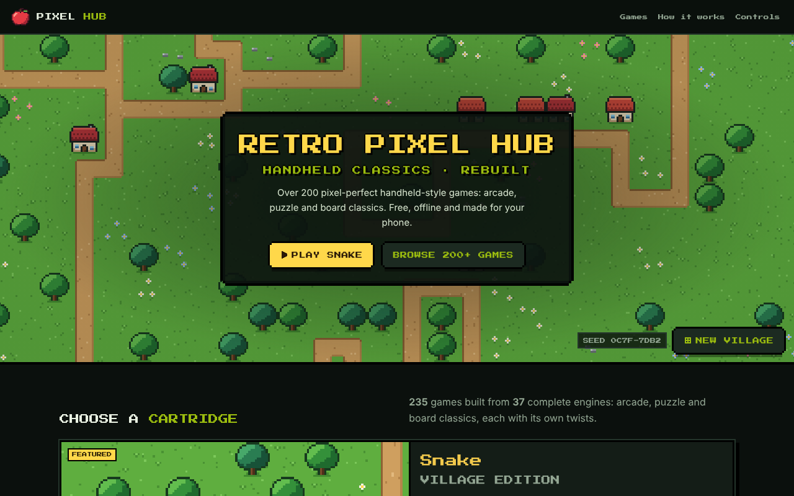
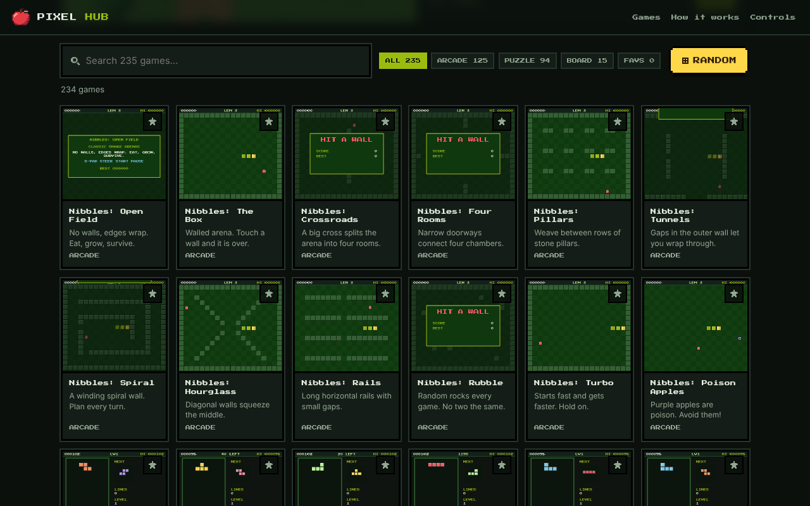
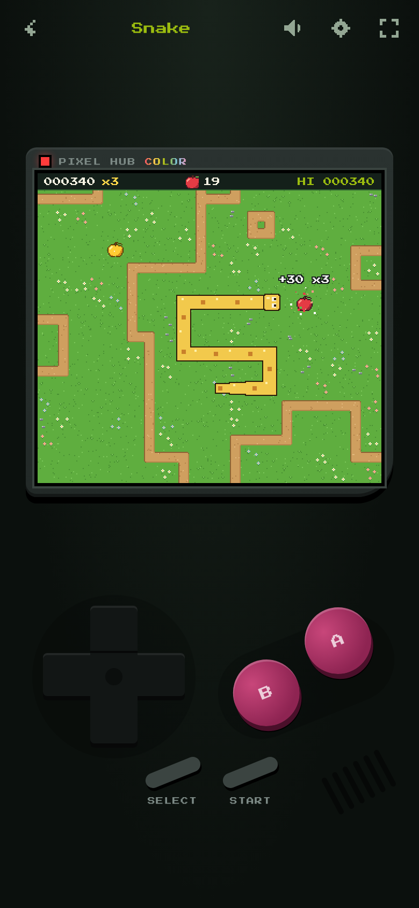
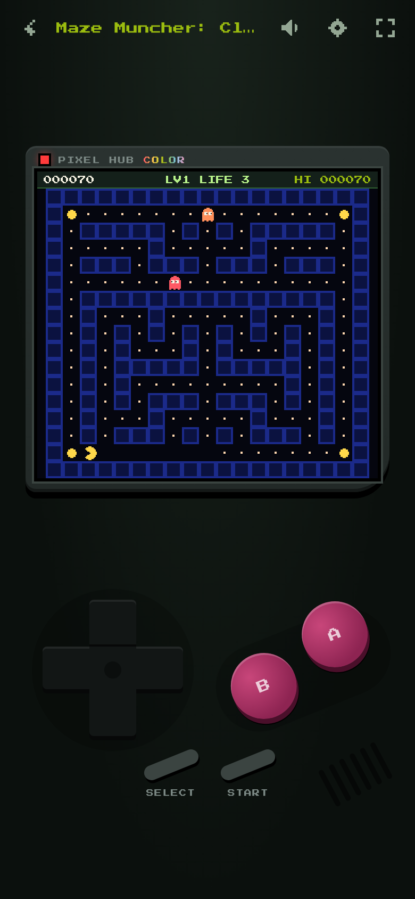
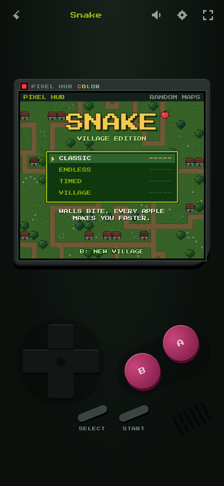
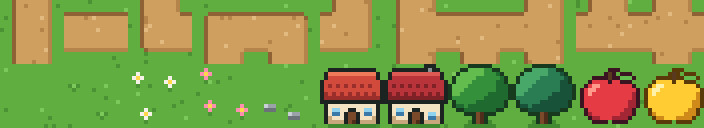

# 🍎 Retro Pixel Hub

**235 free retro pixel games in one offline-ready web app: arcade, puzzle and board classics in a handheld style. The flagship Snake runs through villages generated with Wave Function Collapse.**

**▶ Play now: https://retro-pixel-hub.github.io/**

Pure HTML + CSS + JavaScript. No frameworks, no build step, no image or audio downloads. Push it to GitHub Pages and it works, offline too.





| Snake on a phone | Maze Muncher | Snake title screen |
|---|---|---|
|  |  |  |

---

## 🕹️ The games (235 entries, 37 engines)

Each **engine** is a complete game. Each **entry** is a distinct ruleset for it, with a different board, layout, speed, goal or twist, and its own high score. On the hub you can search them, filter by category, star favourites, jump back into recent games, or hit **Random**.

| Engine | Category | Style | Entries |
|---|---|---|---|
| Snake | Featured | WFC village snake | 1 |
| Nibbles | Arcade | Classic snake arenas | 12 |
| Blocks | Puzzle | Falling-block puzzle | 12 |
| Bricks | Arcade | Paddle and ball | 10 |
| Star Defense | Arcade | Fixed shooter | 8 |
| Rock Blaster | Arcade | Space rocks shooter | 6 |
| Road Hopper | Arcade | Cross roads and rivers | 8 |
| Paddle Duel | Arcade | Table tennis vs CPU | 8 |
| Maze Muncher | Arcade | Dot-eating maze chase | 8 |
| Flappy Pixel | Arcade | One-button flyer | 7 |
| Desert Dash | Arcade | Endless runner | 6 |
| Light Cycles | Arcade | Trail battle vs CPU | 6 |
| Lane Racer | Arcade | Traffic dodger | 6 |
| Fruit Catch | Arcade | Catch the falling fruit | 6 |
| Cave Flyer | Arcade | Hold to climb | 5 |
| Moon Lander | Arcade | Soft landing | 6 |
| Tower Stack | Arcade | Timing stacker | 5 |
| Mole Whack | Arcade | Whack-a-mole | 5 |
| Sky Guard | Arcade | Missile defense | 5 |
| Hop Land | Arcade | Platformer | 8 |
| Mine Sweep | Puzzle | Logic minefield | 8 |
| 2048 | Puzzle | Slide and merge | 8 |
| Crate Push | Puzzle | Push crates onto targets | 7 |
| Lights Out | Puzzle | Switch them all off | 6 |
| Slide | Puzzle | Put the numbers in order | 4 |
| Memory | Puzzle | Find the pairs | 7 |
| Echo | Puzzle | Repeat the sequence | 4 |
| Gem Swap | Puzzle | Match three | 6 |
| Block Pop | Puzzle | Pop colour groups | 5 |
| Maze | Puzzle | Find the exit | 8 |
| Sudoku | Puzzle | Sudoku | 6 |
| Pixel Picture | Puzzle | Nonogram | 5 |
| Code Breaker | Puzzle | Crack the colour code | 5 |
| Peg Jump | Puzzle | Peg solitaire | 3 |
| Tic-Tac-Toe | Board | Line them up vs CPU | 6 |
| Drop Four | Board | Connect four vs CPU | 5 |
| Flip Sides | Board | Reversi vs CPU | 4 |

All names, sprites and sounds are original. The games are tributes to the genres, not copies of any commercial title.

## ✨ Features

- **235 playable games** across arcade, puzzle and board categories, all sharing one handheld look, one control scheme and one high-score system
- **Snake: Village Edition**, the flagship game
  - 4 modes: **Classic** (speeds up), **Endless** (edges wrap), **Timed** (60 s, golden apples add time) and **Village** (houses and trees are solid; clear each village to unlock a denser one)
  - Smooth sub-tile movement on a strict pixel grid, input buffering, combos, golden apples
  - Juice: particle bursts, a bulge that travels down the body, screen shake, hit-flash, a pop-apart death, chimney smoke, a flicking tongue
  - Arenas build in front of you in the exact order WFC collapsed them
- **Reusable Wave Function Collapse engine** (`js/wfc.js`): sockets, entropy, weighted choice, AC-4 propagation, seeds, constraints, retries
- **Two-pass village generator** (`js/village.js`): roads never dead-end, and every front door faces a road
- **Handheld-style player**: integer-scaled canvas, a D-pad you can slide your thumb across, A/B, START/SELECT, swipe-to-steer, keyboard
- **PWA**: install it to your home screen on Android or iOS and play offline
- **Daily maps**: an optional setting gives everyone the same villages today
- Chiptune SFX and an original music loop, synthesised live with Web Audio
- High scores and settings saved in `localStorage`
- Battery-friendly: pauses when hidden, and menus run at 30 fps

## 🎮 Controls

| Action | Keyboard | Touch |
|---|---|---|
| Move / aim | Arrow keys / WASD | D-pad (slide to steer) or swipe the screen |
| A (confirm) | Z / Space | A button, or tap the screen |
| B (back / new village on title) | X | B button |
| Start / pause | Enter / Esc / P | START |
| Mute | M | 🔊 button |
| Full screen | F | ⛶ button |

## 🚀 Run locally

ES modules need a web server (opening `index.html` as a file won't work):

```bash
python3 -m http.server 8080
# or: npx serve .
```

Then open http://localhost:8080.

Run the tests (Node 18+, no dependencies):

```bash
node tests/wfc.test.mjs       # village generator guarantees
node tests/catalog.test.mjs   # 200+ games, unique ids, all precached
```

The tests generate 450 villages and check that no road dead-ends, every door faces a road, seeds are reproducible, and spawn corridors stay clear.

Add `&debug` to a play URL (for example `play.html?game=snake&debug`) to expose the running game as `window.__game` in the console.

## 🌍 Deploy to GitHub Pages

**Option A: no CI (simplest)**
1. Push this folder to the root of a GitHub repo, e.g. `retro-pixel-hub`.
2. Go to **Settings → Pages → Build and deployment → Source: Deploy from a branch**, then choose `main` and `/ (root)`.
3. After a minute, your hub is live at `https://<username>.github.io/retro-pixel-hub/`.

**Option B: GitHub Actions**
A ready workflow is included at `.github/workflows/pages.yml`. It runs the WFC tests, then deploys. Set **Settings → Pages → Source** to **GitHub Actions**.

Every path is relative, so the site works from any sub-folder. If you'd rather serve from `docs/`, move everything into `docs/` and select that folder in Pages settings.

> **After each deploy**, bump `CACHE_VERSION` in `sw.js` so installed copies pick up the new files.

## 🧩 How the villages are made (WFC)



Every tile ("module") has a **socket** on each edge, in the order N, E, S, W:

| Socket | Meaning | Fits with |
|---|---|---|
| `R` | road surface crosses this edge | `R` |
| `s` | side (verge) of a road | `G`, `D`, `H` |
| `G` | grass / open ground | `G`, `H`, `s` |
| `D` | a house's front door | `s` **only** |
| `H` | house wall (houses can stand in rows) | `H`, `G`, `s` |

**Pass 1, layout:** only road pieces (straight, corner, T, cross) plus an abstract *lot* tile. No dead-end piece exists, so every road loops or runs off the map.

**Pass 2, details:** roads are locked in, and every lot collapses into grass, flowers, pebbles, trees or cottages. A cottage's south socket is `D`, which only fits the `s` side of a road, so every door faces a street.

The engine loop works like this:
1. Pick the undecided cell with the **lowest Shannon entropy**, using a little noise to break ties.
2. **Collapse** it to one tile, chosen at random and weighted by each tile's `weight`.
3. **Propagate** with support counting: when a neighbour option loses its last support, ban it, and keep rippling outward.
4. On a contradiction, retry with a derived seed. Results stay reproducible.

### Using the engine in your own game

```js
import { WFC } from './js/wfc.js';

const wfc = new WFC({
  width: 30, height: 12, seed: 'level-1',
  tiles: [
    { id: 'sky',    weight: 10, sockets: ['A', 'A', 'A', 'A'] },
    { id: 'ground', weight: 4,  sockets: ['T', 'B', 'B', 'B'] },
    { id: 'top',    weight: 3,  sockets: ['A', 'T', 'T', 'T'] },
  ],
  socketRules: { A: ['A'], B: ['B'], T: ['T'] },   // made symmetric automatically
  boundary: (socket, dir) => true,                  // optional: rules for edges facing off-map
});
wfc.restrict(0, 11, ['ground']);                    // optional fixed cells
const { ok, grid, order } = wfc.run();              // grid[y][x] = tile id
```

`order` lists the cells in the order they collapsed, which is useful for build-up animations.

## ➕ Adding games

**A new variant (the quickest path)**: add one row to an engine's `variants` list in `js/catalog.js`:

```js
['zigzag', 'Nibbles: Zigzag', 'A zigzag wall maze.', { layout: 'spiral', speed: 10 }],
```

It gets its own card, URL (`play.html?game=nibbles-zigzag`) and high score.

**A new engine**: create `js/arcade/mygame.js` on top of the shared kit:

```js
import { ArcadeGame, module, COL, block } from './kit.js';

class MyGame extends ArcadeGame {
  init()   { this.controls = 'D-PAD MOVE  A JUMP'; }   // one-time setup
  reset()  { this.x = 150; }                           // fresh round (also shown behind the intro)
  onPress(btn) { if (btn === 'a') this.addScore(10, this.x, 100); }
  step(dt) { if (this.isDown('left')) this.x -= 100 * dt; if (this.t > 30) this.end(true, "TIME'S UP"); }
  draw(g)  { block(g, this.x, 120, 16, 16, COL.gold); } // 320x272 playfield under the HUD
  hud()    { return { mid: `${Math.ceil(30 - this.t)}S` }; }
}
export default module(MyGame);
```

The kit gives you the intro card, pause menu, game-over panel, HUD, best scores, particles, screen shake, pop-ups and chiptune SFX. Variant parameters arrive as `this.v`.

Then add an engine block in `js/catalog.js` with an 8×8 icon, and run `node tests/catalog.test.mjs`. It checks that ids are unique, that modules exist, and that every module is listed in `sw.js` for offline play. Add any new file to `PRECACHE` in `sw.js`.

Avoid kit field names in your game (`g`, `t`, `v`, `time`, `state`, `score`, `fx`). Do setup in `init()`, not in class field declarations.

The flagship Snake (`js/games/snake.js`) shows the lower-level module contract (`create(api)` with `update` and `render`) if you'd rather not use the kit.

## 📁 Project structure

```
├── index.html            # landing page / game selector
├── play.html             # handheld-style player shell (?game=<id>)
├── css/style.css
├── js/
│   ├── wfc.js            # reusable Wave Function Collapse engine
│   ├── village.js        # two-pass village generator + validator
│   ├── catalog.js        # all 235 games: engines + variants
│   ├── main.js           # landing page logic
│   ├── shell.js          # player: loop, scaling, input, settings
│   ├── pwa.js            # service worker + install button
│   ├── art/village-art.js  # pixel art tiles & sprites (drawn in code)
│   ├── core/             # rng, input, audio, storage, pixeltext, fx
│   ├── arcade/           # kit.js + 28 engine files (37 game types)
│   └── games/snake.js    # flagship WFC snake
├── assets/
│   ├── fonts/            # Press Start 2P (OFL)
│   ├── icons/            # PWA icons
│   ├── thumbs/           # a real gameplay thumbnail for every game
│   ├── tiles/            # exported tileset (reference)
│   └── screenshots/
├── tests/                # wfc.test.mjs, catalog.test.mjs
├── manifest.json
├── sw.js
└── .github/workflows/pages.yml
```

## 🎨 Art direction

- 16 px tiles on a 320×288 screen (twice the classic 160×144 handheld)
- Strict pixels: no anti-aliasing, integer device-pixel scaling, and canvas text thresholded to pure pixels
- Palette: handheld greens for the UI, with a warm village palette (red roofs, cream walls, dirt roads, two tree greens)

## 📜 Credits & license

- Code: MIT (see `LICENSE`)
- Font: [Press Start 2P](https://fonts.google.com/specimen/Press+Start+2P) by CodeMan38, SIL Open Font License 1.1
- WFC: based on Maxim Gumin's [WaveFunctionCollapse](https://github.com/mxgmn/WaveFunctionCollapse) and the socket-based village approach popularised by SpriteCook

This is a fan-made tribute. It isn't affiliated with or endorsed by any console maker, and every name, sprite and sound in it is original.
